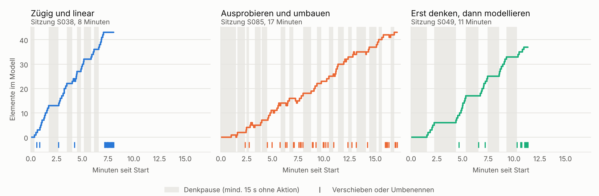
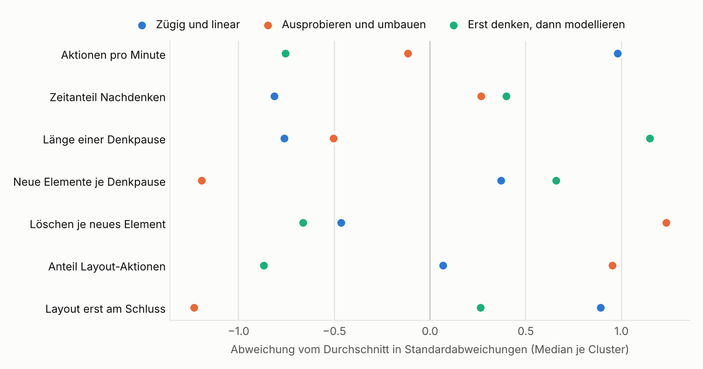

# Modellierstile: wie Menschen Prozessmodelle bauen

Zwei Personen können am Ende dasselbe BPMN-Modell abgeben und trotzdem völlig unterschiedlich gearbeitet haben. Die eine denkt lange nach und baut dann große Stücke am Stück, die andere legt sofort los, die dritte probiert, löscht und schiebt ständig um. Dieses Projekt erkennt solche Stile automatisch aus den Logs eines Modellierungseditors. Jeder Klick ist ein Ereignis mit Zeitstempel. Daraus werden Phasen und Kennzahlen je Sitzung, und ein Clustering gruppiert die Sitzungen.

Die Idee stammt aus der Forschung zum „Process of Process Modeling“. Pinggera u. a. (2015) haben Modellierungssitzungen automatisch aufgezeichnet und mit einer Clusteranalyse drei unterschiedliche Modellierstile gefunden. Dieses Projekt baut die Methode mit simulierten Daten nach. Es repliziert nicht die Ergebnisse der Studie.

## Daten

Simuliert, weil echte Editor-Logs nicht öffentlich verfügbar sind: 120 Sitzungen mit zusammen rund 9.000 Aktionen. In jeder Sitzung entsteht ein Prozessmodell mit 16 bis 26 Knoten. Jede simulierte Person hat einen von drei Stilen mit persönlicher Abweichung. Die Analyse kennt den Stil nicht, er steht nur in `data/sitzungen.csv`, damit man am Ende prüfen kann, ob das Clustering ihn wiederfindet.

`data/modellierlog.csv` hat das Format, das auch ein echter Editor liefern würde:

| sitzung | zeitpunkt | aktion | element |
|---|---|---|---|
| S001 | 2026-03-10 10:58:37.268 | Knoten anlegen | K1 |
| S001 | 2026-03-10 10:59:05.558 | Kante anlegen | E5 |

Mögliche Aktionen: Start, Knoten anlegen, Kante anlegen, Löschen, Verschieben, Umbenennen. Mit echten Daten im selben Format läuft die Analyse unverändert.

## Vorgehen

1. **Phasen.** Eine Pause von mindestens 15 Sekunden ohne Aktion gilt als Nachdenken. Die Abschnitte dazwischen heißen Modellieren, wenn überwiegend Elemente angelegt oder gelöscht werden, sonst Abstimmen (Layout und Namen).
2. **Sieben Kennzahlen je Sitzung:** Aktionen pro Minute, Zeitanteil Nachdenken, Länge einer Denkpause, neue Elemente je Denkpause, Löschen je neues Element, Anteil Layout-Aktionen und welcher Teil des Layouts erst am Schluss passiert.
3. **Clustering.** Kennzahlen standardisieren (rechtsschiefe vorher logarithmieren), k-Means für 2 bis 6 Cluster, Auswahl über den Silhouettenwert. Ward-Clustering als zweites Verfahren zum Vergleich, Stabilität über wiederholte 80-%-Stichproben.
4. **Prüfung.** Übereinstimmung mit den wahren Stilen (Adjusted Rand Index) und Zusammenhang mit der Fehlerzahl im fertigen Modell.
5. **Ablauf je Cluster.** Welche Aktion auf welche folgt, als Directly-Follows-Graph. Die Graphen stehen als Mermaid-Diagramme in `ergebnisse/prozessgraphen.md`, GitHub zeigt sie direkt an.

## Ergebnisse



Jede Grafik zeigt eine typische Sitzung des Clusters, also die mit dem kleinsten Abstand zum Clusterzentrum. Die Linie zählt die Elemente im Modell, Einbrüche sind Löschungen.



| | Zügig und linear | Ausprobieren und umbauen | Erst denken, dann modellieren |
|---|---|---|---|
| Sitzungen | 43 | 38 | 39 |
| Dauer (Median) | 8 min | 18 min | 13 min |
| Aktionen pro Minute | 8,2 | 6,0 | 4,6 |
| Länge einer Denkpause | 27 s | 31 s | 71 s |
| Neue Elemente je Denkpause | 6,6 | 3,0 | 7,6 |
| Löschen je neues Element | 0,04 | 0,20 | 0,02 |
| Layout erst am Schluss | 68 % | 7 % | 50 % |
| Fehler im Modell (Mittel) | 0,63 | 1,76 | 0,31 |

Auch der Ablauf unterscheidet sich: Bei „Zügig“ und „Erst denken“ folgt auf ein neues Element zu 73 bis 74 % gleich das nächste, beim Ausprobieren nur zu 36 %. Dort folgt nach einer Denkpause in 25 % der Fälle zuerst eine Verschiebung, bei den anderen beiden in 4 bis 6 %. Wer ausprobiert, räumt also zwischendurch ständig auf, statt am Schluss.

**Wie gut findet das Verfahren die Stile?**

- Der Silhouettenwert ist bei drei Clustern am höchsten (0,351), aber zwei Cluster liegen knapp dahinter (0,339). Bei echten Daten würde ich die Clusterzahl deshalb nicht allein daran festmachen, sondern auch daran, ob sich die Cluster inhaltlich sinnvoll beschreiben lassen.
- 111 von 120 Sitzungen landen beim richtigen Stil. Adjusted Rand Index gegen die wahren Stile: 0,79 mit k-Means, 0,73 mit Ward. Die beiden Verfahren stimmen untereinander zu 0,88 überein, auf Stichproben ist das Ergebnis sehr stabil (0,99).
- Die meisten Fehlzuordnungen sind nachdenkliche Personen mit eher kurzen Pausen, die bei „Zügig“ landen. Die Grenze zwischen diesen Stilen ist fließend.
- Die Fehlerzahl unterscheidet sich deutlich zwischen den Clustern (Kruskal-Wallis H = 41,9, p < 0,001). Das ist allerdings in die Simulation eingebaut. Es zeigt nur, dass die Methode so einen Zusammenhang finden würde, nicht dass es ihn gibt.

## Grenzen

- Die Daten sind simuliert. In echten Logs entstehen Pausen auch durch Ablenkung, und Aufgabe und Modellgröße beeinflussen das Verhalten. Beides müsste man bei echten Daten berücksichtigen.
- Die Schwelle von 15 Sekunden ist eine Annahme. `merkmale(log, schwelle=...)` erlaubt, andere Werte zu testen.
- Die Einteilung in Modellieren und Abstimmen nach Mehrheit der Aktionen ist grob.
- Die Fehlerzahl wird je Stil direkt simuliert und ist kein echtes Qualitätsmaß.

## Starten

```bash
pip install -r requirements.txt
python analyse.py                      # Kennzahlen, Clustering, Grafiken
pytest                                 # Tests
python -m modellierstile.simulation    # Daten neu erzeugen (liegen schon in data/)
```

GitHub Actions führt Tests und Analyse bei jedem Push aus.

## Projektstruktur

```
modellierstile/
  simulation.py   Editor-Logs für drei Stile simulieren
  merkmale.py     Phasen und Kennzahlen je Sitzung
  cluster.py      Standardisieren, k-Means, Ward, Silhouette, Stabilität, Benennung
  prozess.py      Directly-Follows-Graph und Mermaid-Export
  grafiken.py     Phasendiagramm und Clusterprofile
analyse.py        komplette Analyse
data/             simulierte Logs
ergebnisse/       Kennzahlen, Profile, Übergänge, Prozessgraphen
docs/bilder/      Grafiken für diese README
tests/            Tests, unter anderem mit einer von Hand nachgerechneten Sitzung
```

## Quellen

- Pinggera, J., Soffer, P., Fahland, D., Weidlich, M., Zugal, S., Weber, B., Reijers, H. A., Mendling, J. (2015). Styles in business process modeling: an exploration and a model. *Software & Systems Modeling*, 14(3), 1055–1080. https://doi.org/10.1007/s10270-013-0349-1
- Pinggera, J. u. a. (2012). Modeling styles in business process modeling. In *Enterprise, Business-Process and Information Systems Modeling (BPMDS 2012)*, Springer, 151–166.
